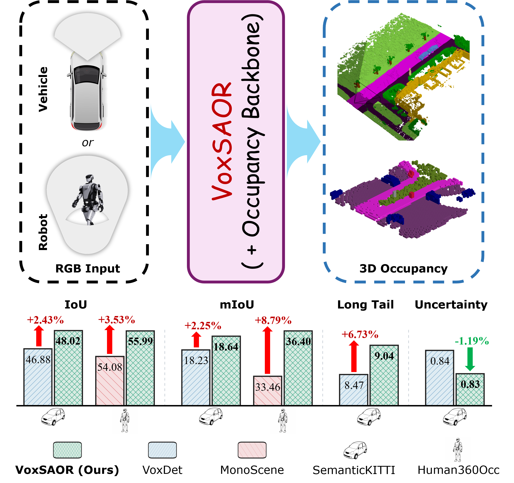
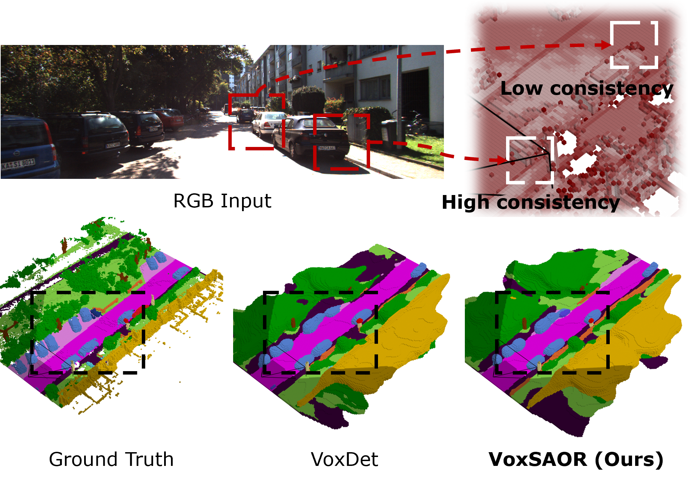
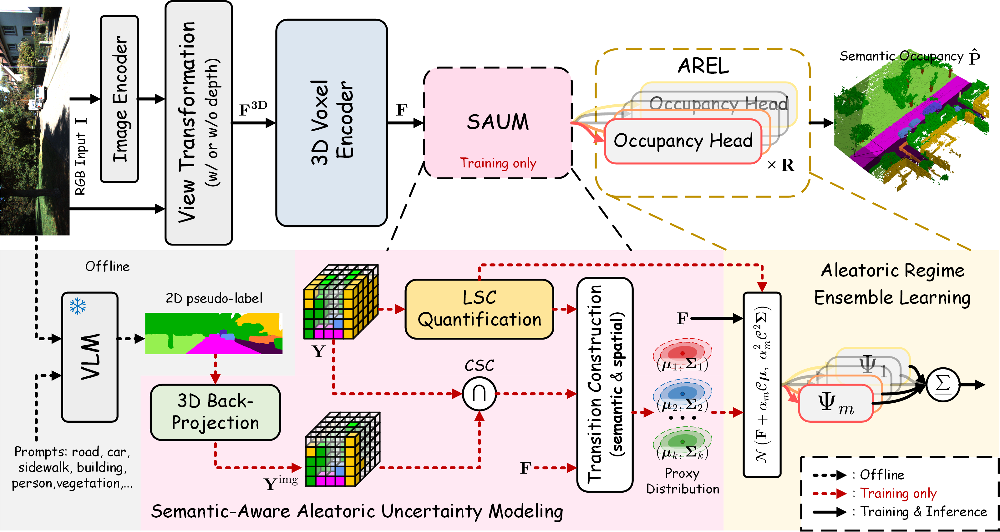

<h1 align="center">VoxSAOR: Semantic-Aware Occupancy Robustification<br>via Aleatoric Uncertainty Modeling</h1>

<p align="center">
  Mengfei Duan, Yuheng Zhang, Guoqiang Zhao, Yuanfan Zheng,<br>
  <a href="https://yangkailun.com">Kailun Yang</a><sup>†</sup>, and <a href="https://robotics.hnu.edu.cn/info/1176/2960.htm">Zhiyong Li</a><sup>†</sup>
</p>
<p align="center">
  <a href="">
    
  </a>
</p>

## 📰 News

- **[2026/11]** Repository initialized.

## 📝 Abstract

Vision-based 3D occupancy prediction provides a dense semantic representation of scenes for autonomous driving and embodied perception, yet remains vulnerable to occlusion, depth ambiguity, and projection errors that induce spatially varying reliability in voxel features. Existing methods typically map voxel representations to semantic predictions without explicitly modeling such observation-induced feature variations. To address this limitation, we propose **VoxSAOR**, a semantic-aware occupancy robustification framework that models aleatoric uncertainty through feature-space proxies. It first quantifies Local Semantic Consistency (LSC) to derive a voxel-wise structural stability prior and uses cross-view semantic consensus to filter unreliable semantic correspondences. Within each semantic category, spatially matched stable and ambiguous voxels form stable-to-ambiguous feature transitions, which are modeled by a class-conditional diagonal Gaussian distribution, capturing both feature displacement and dispersion. Guided by these proxy distributions, Aleatoric Regime Ensemble Learning (AREL) trains independently parameterized prediction heads using feature perturbations at progressively increasing scales, with perturbation strength modulated by structural reliability. At inference, proxy modeling and sampling are disabled, and all heads process the same observed features; their output probabilities are then averaged to produce a deterministic consensus prediction without requiring sampling. Experiments across multiple datasets and occupancy backbones demonstrate the effectiveness of VoxSAOR in improving semantic occupancy prediction, long-tail recognition, and predictive calibration.

<p align="center">
  
</p>

<details>
<summary>🔎 Motivation and qualitative comparison</summary>

<p align="center">
  
</p>

*Local semantic consistency reveals structurally stable and ambiguous regions. The lower row shows ground truth, VoxDet, and VoxSAOR from left to right.*

</details>

## 🧩 Framework

<p align="center">
  
</p>

***Overview of VoxSAOR**. The Semantic-Aware Aleatoric Uncertainty Modeling (SAUM) module constructs class-conditional feature-space proxies using Local Semantic Consistency (LSC) and Cross-View Semantic Consensus (CSC). Guided by these proxies, Aleatoric Regime Ensemble Learning (AREL) trains multiple prediction heads under different perturbation regimes. During inference, proxy modeling and sampling are disabled, and the heads ensemble their predicted class probabilities to produce deterministic, sampling-free semantic occupancy predictions.*

## 🚀 Getting Started

- [Installation]()
- [Data Preparation]()
- [Training & Evaluation]()

## 📚 Citation

If you find this work useful in your research, please consider citing the following paper:

```bibtex
@article{duan2026voxsaor,
  title        = {{VoxSAOR}: {Semantic-aware} Occupancy Robustification via Aleatoric Uncertainty Modeling},
  author       = {Duan, Mengfei and Zhang, Yuheng and Zhao, Guoqiang and Zheng, Yuanfan and Yang, Kailun and Li, Zhiyong},
  journal      = {arXiv preprint arXiv:26011},
  year         = {2026}
}
```

## 🙏 Acknowledgement

We thank the authors of these excellent open-source projects:

- [VoxDet](https://github.com/vita-epfl/VoxDet)
- [CGFormer](https://github.com/pkqbajng/CGFormer)
- [SGN](https://github.com/Jieqianyu/SGN)
- [MonoScene](https://github.com/astra-vision/MonoScene)
